<p align="center">
  
  
  
  
  
  
</p>


<p align="center">
  <a href="#-try-it-in-your-browser"></a>
  <a href="media/dino-bot.mp4"></a>
  <a href="https://github.com/HemashreeVI"></a>
</p>


<p align="center">
  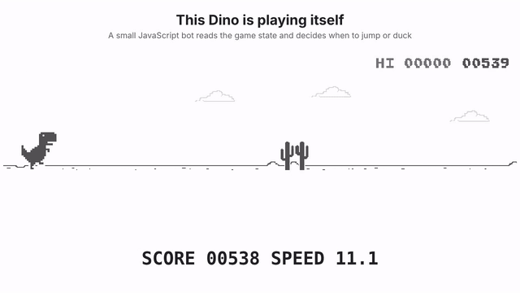
</p>






### ▶ Try it in your browser

No install needed:

1. Open `chrome://dino` in Chrome.
2. Press `F12` and open the **Console** tab.
3. Paste the contents of [`bot.js`](bot.js) and press Enter.
4. Click the game and press Space. Then sit back. 🍿

To stop it, run `stopDinoBot()`.

### 🎥 Run it with Node and record a video

```bash
npm install
npx playwright install chromium
node play.js                      # watch it play
node play.js --record --headless  # save a video to ./videos
node play.js --seconds 300        # play for 5 minutes (default: 90 s)
```

`play.js` uses [Playwright](https://playwright.dev) to open Chromium, load the game, inject the bot and press Space. To turn a `.webm` recording into an `.mp4`:

```bash
ffmpeg -i videos/<file>.webm -c:v libx264 -pix_fmt yuv420p media/dino-bot.mp4
```




<p align="center">
  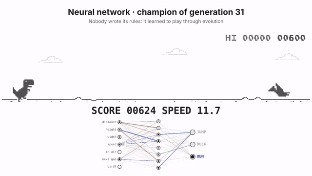
</p>

Then I asked a harder question: **can it learn to play without any rules at all?**

The second bot is a tiny neural network. It sees 7 numbers about the game (how far away the next obstacle is, how high and wide it is, the speed, and so on) and picks one of 3 actions: **JUMP**, **DUCK** or **RUN**. At the start its weights are random, so it plays terribly.


It learns through **neuroevolution**, the same family of ideas as NEAT:

1. 60 random brains each play the real Chrome Dino game 5 times. Their score is their fitness.
2. The 4 best survive unchanged. The rest are replaced by "children": two good parents' weights mixed together, with a few small random mutations.
3. Repeat, generation after generation. Nobody tells it what to do; good behaviour simply survives.


> **Training trick:** the game normally runs in real time, which would make training take days. `nn/train.js` swaps the page's clock for a fake one and drives the game frame by frame, so it runs **hundreds of times faster** than real time, in 4 tabs at once.



Same exam for both: 20 games each, on the same fast-forwarded clock, up to 10 minutes per game (`node nn/exam.js`).
**The hand-written rules still win, but only just.** The network figured out almost everything by itself, starting from random numbers, in 31 generations. 🦖

### 🧠 Train your own brain

```bash
node nn/train.js            # evolve a new brain (a few minutes)
node nn/export.js           # pack it into nn/nn-bot.js
node play.js --brain        # watch it play, with its neurons lighting up
node play.js --brain --gen 1   # compare with the clueless generation-1 brain
node nn/exam.js             # the showdown: rules vs brain, same 20 games
```

Or, without installing anything: paste [`nn/nn-bot.js`](nn/nn-bot.js) into the console on `chrome://dino` and press Space.

<details>
<summary><b>📁 What's in the repo</b></summary>
<br/>

| File | What it does |
| --- | --- |
| [`bot.js`](bot.js) | The bot. Paste it into the console, or let `play.js` inject it. |
| [`play.js`](play.js) | Opens the game, starts a bot (`--brain` for the neural network), records a video. |
| [`nn/network.js`](nn/network.js) | The neural network: what it sees, how it thinks, how it presses keys. |
| [`nn/train.js`](nn/train.js) | Neuroevolution training in the real game, on a fast-forwarded clock. |
| [`nn/brain.json`](nn/brain.json) | The trained brain (its weights). |
| [`nn/training-log.json`](nn/training-log.json) | Scores for every generation, plus each generation's best brain. |
| [`nn/exam.js`](nn/exam.js) | The fair showdown between the two bots. |
| [`nn/nn-bot.js`](nn/nn-bot.js) | The trained brain as one file to paste into the console. |
| [`scripts/build_cards.py`](scripts/build_cards.py) | Generates the cards in this README (`python3 scripts/build_cards.py`). |
| [`media/`](media) | The demo GIF and the full video. |

</details>

<a href="https://github.com/HemashreeVI"></a>
